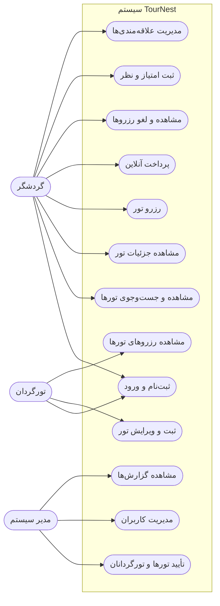

# دیاگرام Use Case — TourNest

## توضیح بازیگران

| بازیگر | توضیح |
|------------|------------------------------------|
| گردشگر | کاربری که تور جست‌وجو و رزرو می‌کند |
| تورگردان | ارائه‌دهندهٔ تور |
| مدیر سیستم | مدیریت و نظارت بر سایت |
